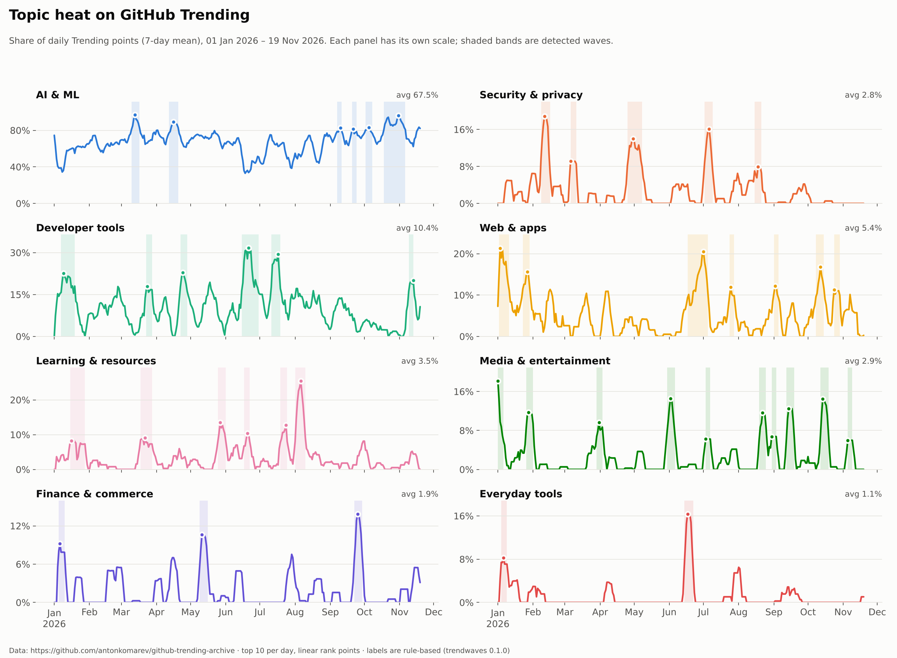
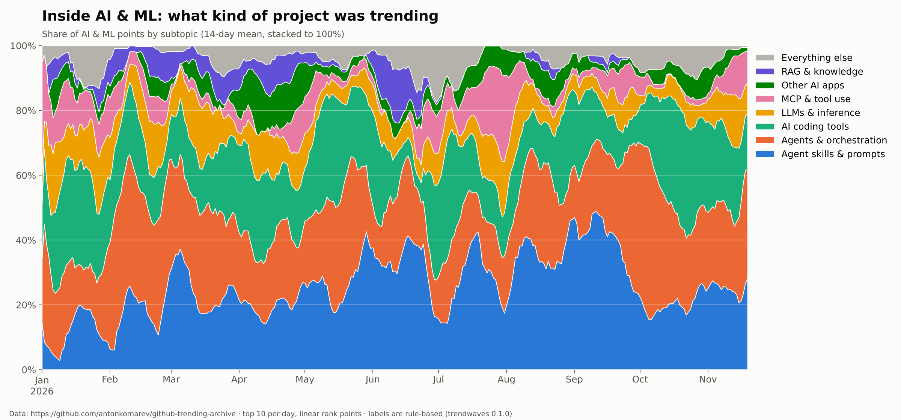
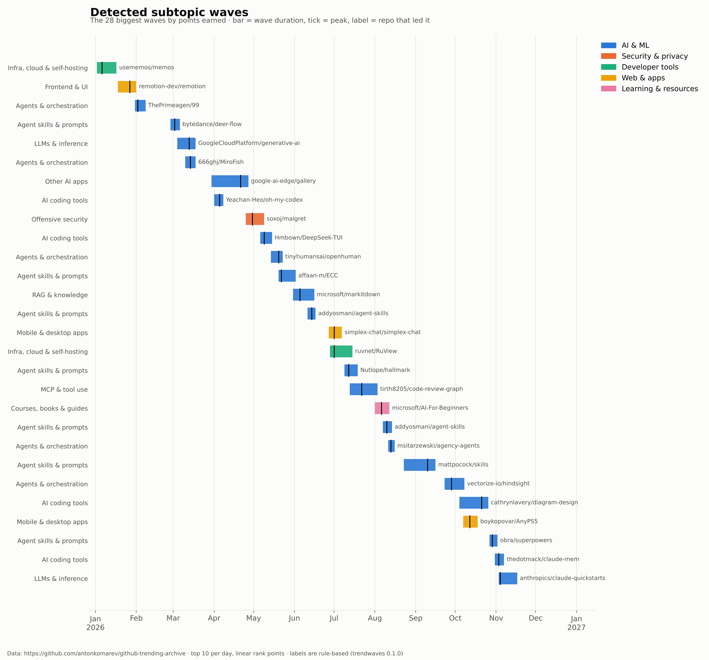
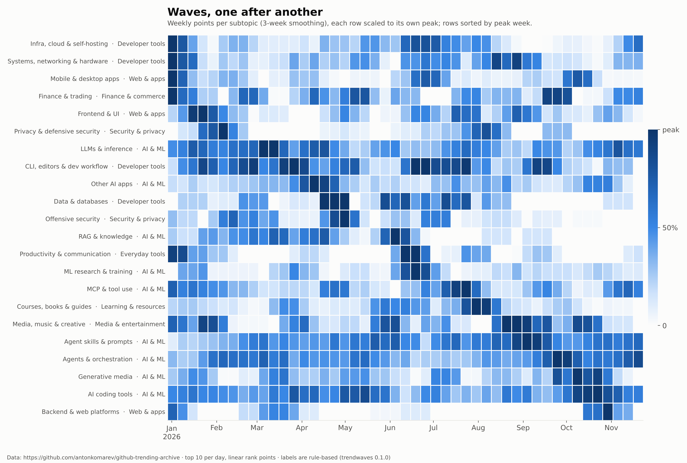

# github-trending-waves

**Watch topics rise and fall on GitHub Trending, one wave at a time.**

`trendwaves` takes the top 10 of the GitHub Trending page for every day in a date range, gives each
repository points by rank, labels it with a topic, and shows how attention moves from one topic to
the next. It finds the **waves** for you: when each topic surged, when it peaked, how unusual the peak
was, and which repositories carried it.



[](https://github.com/YunpengZhao01/github-trending-waves/actions/workflows/ci.yml)


## What 2026 looked like

The charts in this README come from the bundled run over **1 January to 19 November 2026**
(323 days, 3,141 rankings, 906 distinct repositories). Full write-up: [`results/REPORT.md`](results/REPORT.md).

- **AI took about two thirds of all Trending attention** (67.8% of points). Its share dipped in
  June (51%) and reached its high in October (83%).
- **Inside AI, the action moved from models to the tooling around them.** Agent skills and prompt
  packs (17.8% of all points), agent frameworks (17.3%) and AI coding tools (14.1%) each beat
  "LLMs & inference" (5.9%) by a wide margin.
- **The waves alternate.** Skills, agents and coding tools take turns at the top, each surge lasting
  one to three weeks. MCP had its biggest wave in late July, and the largest single wave of the
  year was the agent-skills surge of late August to mid-September.
- **Outside AI, waves are short and sharp:** security tooling in February, from late April to early May, and in July, a
  self-hosting and dev-tools surge in late June, and a learning-resources spike in early August.







> These are rule-based labels on a third-party archive. Treat them as a well-documented first pass,
> not ground truth: see [Limitations](#limitations).

## Quick start

```bash
git clone https://github.com/YunpengZhao01/github-trending-waves.git
cd github-trending-waves
python -m pip install .

export GITHUB_TOKEN=ghp_...        # optional but recommended (see below)
trendwaves run --start 2026-01-01 --out results
```

The first run downloads one small JSON file per day and the GitHub metadata for every repository
in the window. Both are cached in `.trendwaves-cache/`, so later runs only fetch what is new, and
`--offline` re-runs entirely from the cache.

**About the token.** Daily rankings come from `raw.githubusercontent.com` and need no token.
Repository descriptions and topics come from the GitHub API, which is what makes classification
work. Without a token it still works, but more slowly (10 search requests a minute instead of 30).
Any classic or fine-grained token with no extra scopes will do. `GH_TOKEN` is also accepted.

## How it works

```
 daily snapshots       rank points          labels              daily scores          waves
 (archive, cached) ──► 1st=10 … 10th=1 ──► topic/subtopic ──► 7-day mean, share ──► start · peak · end
                                           (TOML rules)                              lift · who led it
```

1. **Data.** GitHub does not publish past Trending pages, so the tool reads
   [antonkomarev/github-trending-archive](https://github.com/antonkomarev/github-trending-archive),
   which snapshots the all-languages daily Trending page every day.
2. **Scoring.** By default rank 1 earns 10 points and rank 10 earns 1, so every full day holds 55
   points. A topic's score is its **share of the Trending page's attention**. Other schemes:
   `--scoring reciprocal` (1/rank) and `--scoring flat` (presence only).
3. **Classification.** Each repository gets one `(topic, subtopic)` label from an ordered list of
   regular expressions, matched first against its name and description and then, if nothing
   matched, against its GitHub topics too. Hand-picked overrides come first. Everything lives in
   one editable file: [`default_taxonomy.toml`](src/trendwaves/default_taxonomy.toml).
4. **Waves.** For every topic and subtopic, a wave is a run of at least 5 days on which the smoothed
   score stays above `mean + 0.75 × std` of that category's own history (gaps of 3 days or less are
   merged). Because the bar is relative, a small topic's surge is as visible as a big one's.

The details, including every formula, are in [`docs/methodology.md`](docs/methodology.md).

## Outputs

| file | what is in it |
|---|---|
| `REPORT.md` | Readable summary: shares, rising and cooling subtopics, biggest waves, top repositories, data quality |
| `topic_panels.png` | One panel per topic, with its own scale and detected waves shaded |
| `lead_topic_mix.png` | Subtopic mix inside the dominant topic (stacked to 100%) |
| `wave_timeline.png` | The biggest subtopic waves as bars, labelled with the repository that led each one |
| `subtopic_heatmap.png` | Weekly heat per subtopic, rows sorted by peak week |
| `topic_streamgraph.png` | Streamgraph of topic shares |
| `waves.csv` | Every detected wave: start, peak, end, days, peak share, lift, points, top repositories |
| `daily_top.csv` | Every (date, rank, repository) with points, labels and a link to the source snapshot |
| `repositories.csv` | Per repository: total points, days in top N, best rank, label, the text that triggered it, description, stars |
| `daily_topic_scores.csv`, `daily_subtopic_scores.csv` | Daily raw points, smoothed points and share per category |
| `coverage.json` | Missing days, request errors, metadata coverage, classification breakdown, unclassified share |

## Command reference

```bash
trendwaves run       # fetch → classify → score → waves → charts + report
trendwaves fetch     # only fill the cache (e.g. on a machine with network access)
trendwaves classify owner/name ...   # show which label a repo gets and why
```

Useful `run` options:

| option | default | meaning |
|---|---|---|
| `--start`, `--end` | `2026-01-01`, yesterday | date range (`--end today` also works) |
| `--top` | `10` | how many repositories per day to score |
| `--scoring` | `linear` | `linear`, `reciprocal` or `flat` |
| `--smooth` | `7` | trailing moving-average window, in days |
| `--taxonomy` | built-in | your own TOML taxonomy |
| `--wave-z`, `--wave-min-days` | `0.75`, `5` | wave sensitivity |
| `--offline` | off | never touch the network; use the cache only |
| `--no-metadata` | off | classify from repository names only |
| `--out`, `--cache` | `results`, `.trendwaves-cache` | where outputs and the cache go |

You can also run it as a module: `python -m trendwaves run ...`.

## Customising the topics

Copy the default taxonomy, edit it, and point the tool at it:

```bash
cp src/trendwaves/default_taxonomy.toml my_topics.toml
trendwaves run --taxonomy my_topics.toml --offline
```

```toml
[overrides]
"astral-sh/uv" = "Developer tools / Package & build tools"

[[rule]]
topic = "AI & ML"
subtopic = "MCP & tool use"
pattern = '\bmcp\b|model context protocol|tool calling'
```

Rules are tried from top to bottom and the first match wins, so put specific subtopics above broad
ones. To see why something was labelled the way it was:

```bash
$ trendwaves classify ChromeDevTools/chrome-devtools-mcp
ChromeDevTools/chrome-devtools-mcp: AI & ML / MCP & tool use [metadata]  (matched "mcp")
```

## Keep it up to date automatically

[`.github/workflows/update.yml`](.github/workflows/update.yml) re-runs the analysis every morning
and commits the refreshed `results/`, so the charts in this README stay current. To turn it on in
your copy, go to **Settings → Actions → General → Workflow permissions** and choose
**Read and write permissions**. It uses the built-in `GITHUB_TOKEN`; no secrets to add.

## Limitations

- **Attention, not popularity.** Trending ranks recent star growth. These numbers describe what
  the Trending page highlighted, not total usage or how important a project is.
- **Labels use today's metadata.** Descriptions and topics are fetched now, not as they were on the
  day a repository trended.
- **One label per repository.** A multi-purpose project is assigned to its first matching rule.
  The `matched_text` column in `repositories.csv` makes these decisions easy to audit.
- **English-centric rules.** Repositories described only in other languages are more likely to stay
  unclassified. In the bundled run, 64 of 906 repositories (4.5% of points) are unclassified, mostly
  renamed or deleted repositories with no metadata left.
- **Third-party source.** The archive is a community scrape. Missing days are recorded in
  `coverage.json` and left out of the charts, never counted as zero.

## Development

```bash
python -m venv .venv && source .venv/bin/activate
pip install -e ".[dev]"
ruff check .
pytest -q
```

Contributions are welcome, especially better taxonomy rules. See [CONTRIBUTING.md](CONTRIBUTING.md).

## Credits and licence

- Daily rankings: [antonkomarev/github-trending-archive](https://github.com/antonkomarev/github-trending-archive).
  Please credit it if you publish results.
- Repository metadata: the [GitHub REST API](https://docs.github.com/en/rest).
- Code released under the [MIT License](LICENSE). Generated charts and tables in `results/` may be
  reused with attribution to this project and to the archive above.
