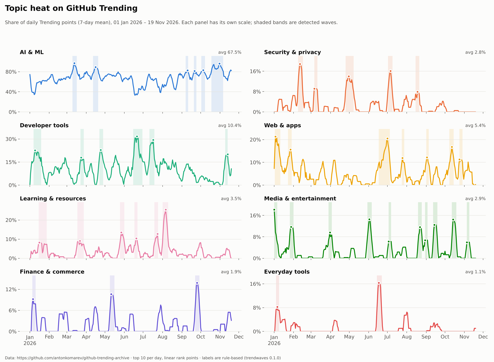
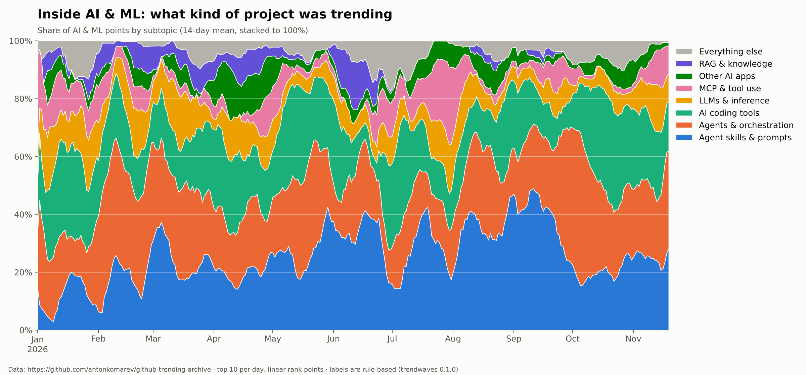
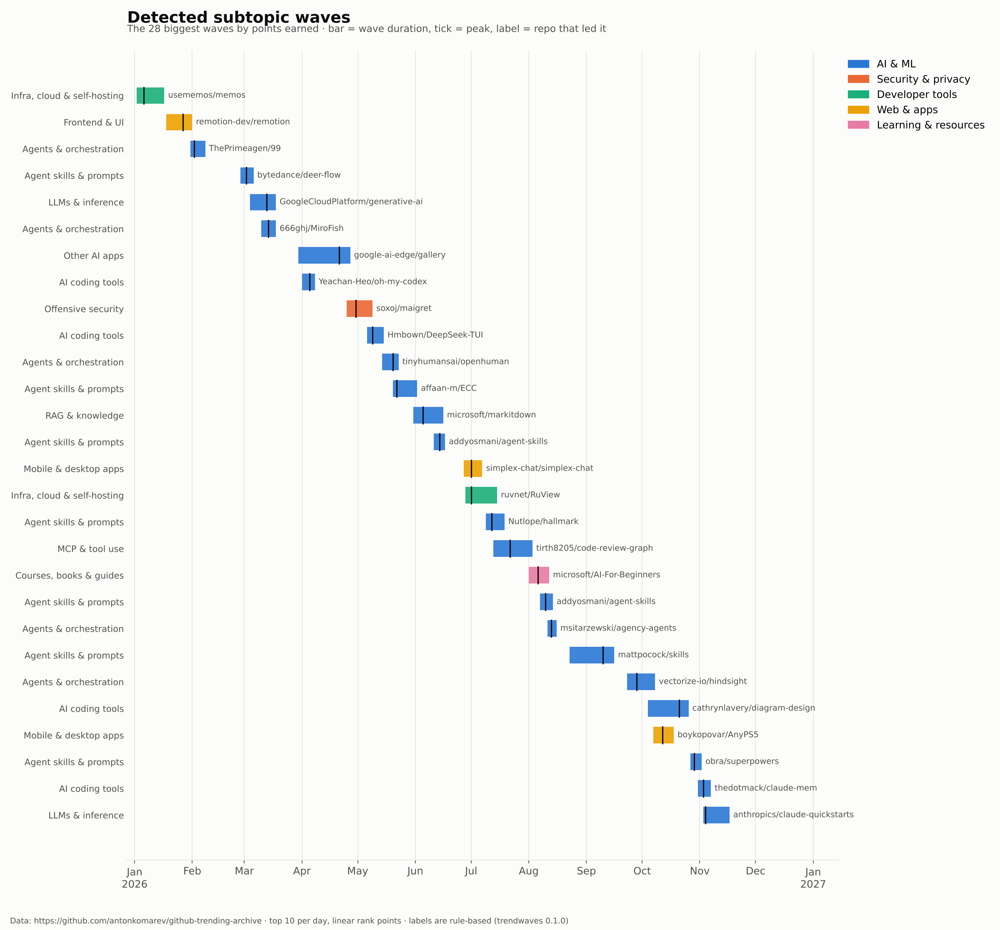

# GitHub Trending topic waves: 2026-01-01 to 2026-11-19

Top 10 of the daily *All languages* Trending page, scored with the `linear` scheme and smoothed over 7 days. 323 of 323 days were available in the archive; 906 distinct repositories appeared.

## Where the attention went

| topic | share of all points (%) |
| --- | --- |
| AI & ML | 67.8 |
| Developer tools | 10.5 |
| Web & apps | 5.3 |
| Other | 4.4 |
| Learning & resources | 3.5 |
| Security & privacy | 2.8 |
| Media & entertainment | 2.7 |
| Finance & commerce | 1.9 |
| Everyday tools | 1.1 |

## Rising and cooling right now

Average daily points over the last 14 days compared with the 56 days before that (subtopics).

**Rising**

| subtopic | last 14 days (pts/day) | previous 56 days (pts/day) | change |
| --- | --- | --- | --- |
| Infra, cloud & self-hosting | 2.79 | 0.2 | 2.59 |
| MCP & tool use | 3.93 | 1.75 | 2.18 |
| Systems, networking & hardware | 2.14 | 0.45 | 1.69 |
| Agent skills & prompts | 11.5 | 10.05 | 1.45 |
| Science & research | 1.43 | 0.14 | 1.29 |

**Cooling**

| subtopic | last 14 days (pts/day) | previous 56 days (pts/day) | change |
| --- | --- | --- | --- |
| AI coding tools | 7.07 | 10.05 | -2.98 |
| Media, music & creative | 0 | 2.27 | -2.27 |
| Generative media | 0 | 2 | -2 |
| Mobile & desktop apps | 0.14 | 2.02 | -1.88 |
| Other AI apps | 0.5 | 1.88 | -1.38 |

## Biggest subtopic waves

| subtopic | start | peak | end | days | lift × | points | led by |
| --- | --- | --- | --- | --- | --- | --- | --- |
| Agent skills & prompts | 2026-08-23 | 2026-09-10 | 2026-09-15 | 24 | 2.54 | 420 | [mattpocock/skills](https://github.com/mattpocock/skills) |
| AI coding tools | 2026-10-04 | 2026-10-21 | 2026-10-25 | 22 | 2.6 | 305 | [cathrynlavery/diagram-design](https://github.com/cathrynlavery/diagram-design) |
| Agents & orchestration | 2026-09-23 | 2026-09-28 | 2026-10-07 | 15 | 2.72 | 297 | [vectorize-io/hindsight](https://github.com/vectorize-io/hindsight) |
| Agent skills & prompts | 2026-05-20 | 2026-05-22 | 2026-06-01 | 13 | 1.75 | 185 | [affaan-m/ECC](https://github.com/affaan-m/ECC) |
| Other AI apps | 2026-03-30 | 2026-04-21 | 2026-04-26 | 28 | 4.84 | 149 | [google-ai-edge/gallery](https://github.com/google-ai-edge/gallery) |
| Agent skills & prompts | 2026-07-09 | 2026-07-12 | 2026-07-18 | 10 | 1.99 | 148 | [Nutlope/hallmark](https://github.com/Nutlope/hallmark) |
| Agents & orchestration | 2026-05-14 | 2026-05-20 | 2026-05-22 | 9 | 1.87 | 141 | [tinyhumansai/openhuman](https://github.com/tinyhumansai/openhuman) |
| Agents & orchestration | 2026-03-10 | 2026-03-14 | 2026-03-17 | 8 | 2.3 | 137 | [666ghj/MiroFish](https://github.com/666ghj/MiroFish) |
| Agents & orchestration | 2026-01-31 | 2026-02-02 | 2026-02-07 | 8 | 1.96 | 127 | [ThePrimeagen/99](https://github.com/ThePrimeagen/99) |
| AI coding tools | 2026-05-06 | 2026-05-09 | 2026-05-14 | 9 | 2.39 | 122 | [Hmbown/DeepSeek-TUI](https://github.com/Hmbown/DeepSeek-TUI) |
| MCP & tool use | 2026-07-13 | 2026-07-22 | 2026-08-02 | 21 | 4.43 | 121 | [tirth8205/code-review-graph](https://github.com/tirth8205/code-review-graph) |
| LLMs & inference | 2026-03-04 | 2026-03-13 | 2026-03-17 | 14 | 2.8 | 106 | [GoogleCloudPlatform/generative-ai](https://github.com/GoogleCloudPlatform/generative-ai) |
| AI coding tools | 2026-10-31 | 2026-11-03 | 2026-11-06 | 7 | 2.11 | 100 | [thedotmack/claude-mem](https://github.com/thedotmack/claude-mem) |
| Agent skills & prompts | 2026-02-27 | 2026-03-02 | 2026-03-05 | 7 | 1.93 | 97 | [bytedance/deer-flow](https://github.com/bytedance/deer-flow) |
| Agent skills & prompts | 2026-08-07 | 2026-08-10 | 2026-08-13 | 7 | 1.97 | 95 | [addyosmani/agent-skills](https://github.com/addyosmani/agent-skills) |

## Topic waves

| topic | start | peak | end | days | lift × | points | led by |
| --- | --- | --- | --- | --- | --- | --- | --- |
| Media & entertainment | 2026-01-01 | 2026-01-01 | 2026-01-06 | 6 | 6.42 | 19 | [afkarxyz/SpotiFLAC](https://github.com/afkarxyz/SpotiFLAC) |
| Web & apps | 2026-01-02 | 2026-01-03 | 2026-01-11 | 10 | 3.97 | 80 | [HQarroum/docker-android](https://github.com/HQarroum/docker-android) |
| Everyday tools | 2026-01-04 | 2026-01-06 | 2026-01-09 | 6 | 7.71 | 20 | [ourongxing/newsnow](https://github.com/ourongxing/newsnow) |
| Finance & commerce | 2026-01-05 | 2026-01-06 | 2026-01-10 | 6 | 4.82 | 18 | [OpenBB-finance/OpenBB](https://github.com/OpenBB-finance/OpenBB) |
| Developer tools | 2026-01-07 | 2026-01-09 | 2026-01-19 | 13 | 2.16 | 128 | [protocolbuffers/protobuf](https://github.com/protocolbuffers/protobuf) |
| Learning & resources | 2026-01-15 | 2026-01-16 | 2026-01-28 | 14 | 2.3 | 37 | [twitter/the-algorithm](https://github.com/twitter/the-algorithm) |
| Web & apps | 2026-01-23 | 2026-01-27 | 2026-01-29 | 7 | 2.82 | 44 | [remotion-dev/remotion](https://github.com/remotion-dev/remotion) |
| Media & entertainment | 2026-01-26 | 2026-01-28 | 2026-02-01 | 7 | 3.95 | 35 | [Blaizzy/mlx-audio](https://github.com/Blaizzy/mlx-audio) |
| Security & privacy | 2026-02-08 | 2026-02-11 | 2026-02-16 | 9 | 6.71 | 63 | [KeygraphHQ/shannon](https://github.com/KeygraphHQ/shannon) |
| Security & privacy | 2026-03-06 | 2026-03-06 | 2026-03-11 | 6 | 3.26 | 15 | [KeygraphHQ/shannon](https://github.com/KeygraphHQ/shannon) |
| AI & ML | 2026-03-10 | 2026-03-13 | 2026-03-17 | 8 | 1.44 | 373 | [666ghj/MiroFish](https://github.com/666ghj/MiroFish) |
| Learning & resources | 2026-03-18 | 2026-03-22 | 2026-03-28 | 11 | 2.45 | 37 | [Crosstalk-Solutions/project-nomad](https://github.com/Crosstalk-Solutions/project-nomad) |
| Developer tools | 2026-03-23 | 2026-03-24 | 2026-03-28 | 6 | 1.63 | 41 | [FujiwaraChoki/MoneyPrinterV2](https://github.com/FujiwaraChoki/MoneyPrinterV2) |
| Media & entertainment | 2026-03-29 | 2026-03-31 | 2026-04-03 | 6 | 3.39 | 21 | [hacksider/Deep-Live-Cam](https://github.com/hacksider/Deep-Live-Cam) |
| AI & ML | 2026-04-12 | 2026-04-16 | 2026-04-20 | 9 | 1.33 | 415 | [forrestchang/andrej-karpathy-skills](https://github.com/forrestchang/andrej-karpathy-skills) |
| Developer tools | 2026-04-22 | 2026-04-24 | 2026-04-28 | 7 | 2.21 | 62 | [Fincept-Corporation/FinceptTerminal](https://github.com/Fincept-Corporation/FinceptTerminal) |
| Security & privacy | 2026-04-25 | 2026-04-30 | 2026-05-08 | 14 | 5.03 | 82 | [soxoj/maigret](https://github.com/soxoj/maigret) |
| Finance & commerce | 2026-05-09 | 2026-05-11 | 2026-05-16 | 8 | 5.64 | 34 | [anthropics/financial-services](https://github.com/anthropics/financial-services) |
| Learning & resources | 2026-05-25 | 2026-05-27 | 2026-06-01 | 8 | 3.86 | 40 | [rohitg00/ai-engineering-from-scratch](https://github.com/rohitg00/ai-engineering-from-scratch) |
| Media & entertainment | 2026-05-30 | 2026-06-02 | 2026-06-06 | 8 | 5.14 | 36 | [harry0703/MoneyPrinterTurbo](https://github.com/harry0703/MoneyPrinterTurbo) |
| Everyday tools | 2026-06-14 | 2026-06-17 | 2026-06-22 | 9 | 15.42 | 57 | [iptv-org/iptv](https://github.com/iptv-org/iptv) |
| Developer tools | 2026-06-15 | 2026-06-21 | 2026-06-30 | 16 | 3.07 | 218 | [palmier-io/palmier-pro](https://github.com/palmier-io/palmier-pro) |
| Learning & resources | 2026-06-17 | 2026-06-20 | 2026-06-22 | 6 | 2.97 | 24 | [freeCodeCamp/freeCodeCamp](https://github.com/freeCodeCamp/freeCodeCamp) |
| Web & apps | 2026-06-17 | 2026-07-01 | 2026-07-05 | 19 | 3.84 | 129 | [simplex-chat/simplex-chat](https://github.com/simplex-chat/simplex-chat) |
| Security & privacy | 2026-07-02 | 2026-07-06 | 2026-07-09 | 8 | 5.78 | 41 | [usestrix/strix](https://github.com/usestrix/strix) |
| Media & entertainment | 2026-07-03 | 2026-07-03 | 2026-07-07 | 5 | 2.2 | 7 | [hasaneyldrm/exercises-dataset](https://github.com/hasaneyldrm/exercises-dataset) |
| Developer tools | 2026-07-11 | 2026-07-17 | 2026-07-19 | 9 | 2.84 | 125 | [OpenCut-app/OpenCut](https://github.com/OpenCut-app/OpenCut) |
| Learning & resources | 2026-07-19 | 2026-07-24 | 2026-07-25 | 7 | 3.64 | 31 | [rohitg00/ai-engineering-from-scratch](https://github.com/rohitg00/ai-engineering-from-scratch) |
| Web & apps | 2026-07-24 | 2026-07-25 | 2026-07-28 | 5 | 2.23 | 18 | [koala73/worldmonitor](https://github.com/koala73/worldmonitor) |
| Learning & resources | 2026-08-01 | 2026-08-06 | 2026-08-10 | 10 | 7.28 | 92 | [microsoft/AI-For-Beginners](https://github.com/microsoft/AI-For-Beginners) |
| Security & privacy | 2026-08-15 | 2026-08-18 | 2026-08-21 | 7 | 2.8 | 25 | [megadose/holehe](https://github.com/megadose/holehe) |
| Media & entertainment | 2026-08-19 | 2026-08-22 | 2026-08-25 | 7 | 4.04 | 34 | [harry0703/MoneyPrinterTurbo](https://github.com/harry0703/MoneyPrinterTurbo) |
| Media & entertainment | 2026-08-30 | 2026-08-30 | 2026-09-03 | 5 | 2.39 | 9 | [bilawalsidhu/gods-eye-view](https://github.com/bilawalsidhu/gods-eye-view) |
| Web & apps | 2026-09-01 | 2026-09-02 | 2026-09-05 | 5 | 2.28 | 21 | [iv-org/invidious](https://github.com/iv-org/invidious) |
| AI & ML | 2026-09-07 | 2026-09-10 | 2026-09-11 | 5 | 1.24 | 211 | [ayghri/i-have-adhd](https://github.com/ayghri/i-have-adhd) |
| Media & entertainment | 2026-09-12 | 2026-09-14 | 2026-09-19 | 8 | 4.4 | 38 | [bilawalsidhu/gods-eye-view](https://github.com/bilawalsidhu/gods-eye-view) |
| AI & ML | 2026-09-20 | 2026-09-21 | 2026-09-24 | 5 | 1.22 | 197 | [BuilderIO/agent-native](https://github.com/BuilderIO/agent-native) |
| Finance & commerce | 2026-09-22 | 2026-09-25 | 2026-09-29 | 8 | 7.29 | 41 | [anthropics/financial-services](https://github.com/anthropics/financial-services) |
| AI & ML | 2026-10-02 | 2026-10-05 | 2026-10-08 | 7 | 1.23 | 295 | [DietrichGebert/ponytail](https://github.com/DietrichGebert/ponytail) |
| Web & apps | 2026-10-08 | 2026-10-12 | 2026-10-15 | 8 | 3.11 | 52 | [boykopovar/AnyPS5](https://github.com/boykopovar/AnyPS5) |
| Media & entertainment | 2026-10-12 | 2026-10-14 | 2026-10-19 | 8 | 5.05 | 42 | [bilawalsidhu/gods-eye-view](https://github.com/bilawalsidhu/gods-eye-view) |
| AI & ML | 2026-10-18 | 2026-10-31 | 2026-11-06 | 20 | 1.44 | 959 | [thedotmack/claude-mem](https://github.com/thedotmack/claude-mem) |
| Web & apps | 2026-10-24 | 2026-10-24 | 2026-10-29 | 6 | 2.09 | 19 | [Renhuai123/ziwei-doushu](https://github.com/Renhuai123/ziwei-doushu) |
| Media & entertainment | 2026-11-05 | 2026-11-05 | 2026-11-09 | 5 | 2.11 | 9 | [floci-io/floci](https://github.com/floci-io/floci) |
| Developer tools | 2026-11-09 | 2026-11-13 | 2026-11-13 | 5 | 1.94 | 44 | [sherlock-project/sherlock](https://github.com/sherlock-project/sherlock) |

## Most persistent repositories

| repository | subtopic | total_points | days_in_top | best_rank |
| --- | --- | --- | --- | --- |
| [obra/superpowers](https://github.com/obra/superpowers) | Agent skills & prompts | 501 | 88 | 1 |
| [mattpocock/skills](https://github.com/mattpocock/skills) | Agent skills & prompts | 297 | 39 | 1 |
| [addyosmani/agent-skills](https://github.com/addyosmani/agent-skills) | Agent skills & prompts | 206 | 29 | 1 |
| [thedotmack/claude-mem](https://github.com/thedotmack/claude-mem) | AI coding tools | 192 | 26 | 1 |
| [affaan-m/ECC](https://github.com/affaan-m/ECC) | Agent skills & prompts | 186 | 29 | 1 |
| [NousResearch/hermes-agent](https://github.com/NousResearch/hermes-agent) | Agents & orchestration | 160 | 27 | 1 |
| [msitarzewski/agency-agents](https://github.com/msitarzewski/agency-agents) | Agents & orchestration | 143 | 23 | 1 |
| [anthropics/claude-plugins-official](https://github.com/anthropics/claude-plugins-official) | AI coding tools | 134 | 18 | 1 |
| [mvanhorn/last30days-skill](https://github.com/mvanhorn/last30days-skill) | Agent skills & prompts | 128 | 19 | 1 |
| [ruvnet/RuView](https://github.com/ruvnet/RuView) | Infra, cloud & self-hosting | 120 | 20 | 1 |
| [ChromeDevTools/chrome-devtools-mcp](https://github.com/ChromeDevTools/chrome-devtools-mcp) | MCP & tool use | 118 | 19 | 1 |
| [microsoft/markitdown](https://github.com/microsoft/markitdown) | RAG & knowledge | 117 | 16 | 1 |
| [cathrynlavery/diagram-design](https://github.com/cathrynlavery/diagram-design) | AI coding tools | 115 | 16 | 1 |
| [harry0703/MoneyPrinterTurbo](https://github.com/harry0703/MoneyPrinterTurbo) | Media, music & creative | 112 | 15 | 1 |
| [anthropics/claude-code](https://github.com/anthropics/claude-code) | AI coding tools | 108 | 19 | 1 |
| [K-Dense-AI/scientific-agent-skills](https://github.com/K-Dense-AI/scientific-agent-skills) | Agent skills & prompts | 104 | 16 | 2 |
| [cloudflare/security-audit-skill](https://github.com/cloudflare/security-audit-skill) | Agent skills & prompts | 102 | 12 | 1 |
| [ruvnet/ruflo](https://github.com/ruvnet/ruflo) | AI coding tools | 100 | 18 | 1 |
| [rohitg00/ai-engineering-from-scratch](https://github.com/rohitg00/ai-engineering-from-scratch) | Courses, books & guides | 99 | 18 | 1 |
| [TauricResearch/TradingAgents](https://github.com/TauricResearch/TradingAgents) | Agents & orchestration | 99 | 16 | 1 |

## Data quality

- Missing archive days: 0; request errors: 0
- Repositories with GitHub metadata: 837 / 906
- Unclassified: 64 repositories (4.5% of points)
- Labels come from each repository's *current* description and topics, not from the day it trended.