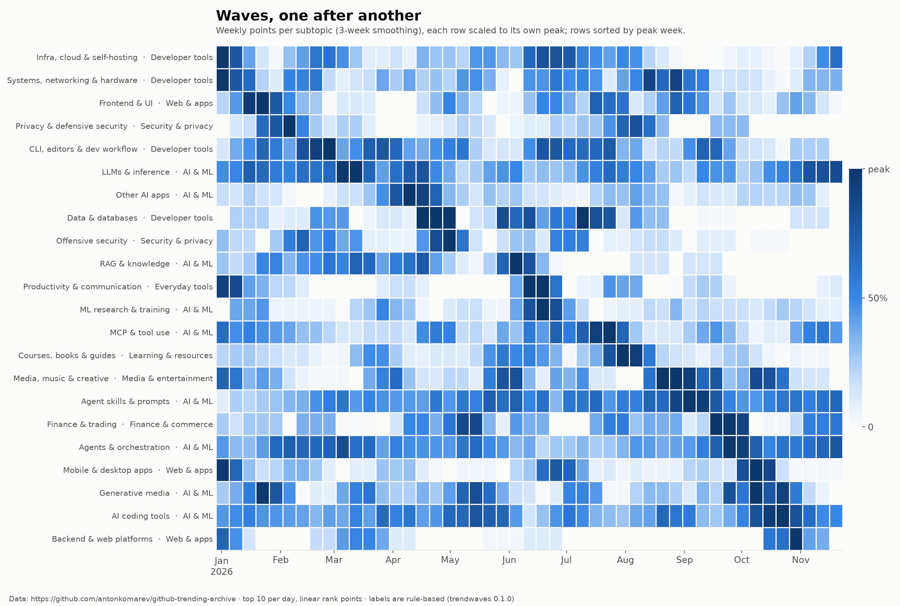

# GitHub Trending topic waves: 2026-01-01 to 2026-11-21

Top 10 of the daily *All languages* Trending page, scored with the `linear` scheme and smoothed over 7 days. 325 of 325 days were available in the archive; 907 distinct repositories appeared.

## Where the attention went

| topic | share of all points (%) |
| --- | --- |
| AI & ML | 70.4 |
| Developer tools | 11.1 |
| Web & apps | 5.4 |
| Learning & resources | 3.4 |
| Security & privacy | 2.9 |
| Media & entertainment | 2.5 |
| Other | 1.6 |
| Finance & commerce | 1.5 |
| Everyday tools | 1 |

## Rising and cooling right now

Average daily points over the last 14 days compared with the 56 days before that (subtopics).

**Rising**

| subtopic | last 14 days (pts/day) | previous 56 days (pts/day) | change |
| --- | --- | --- | --- |
| Agent skills & prompts | 13.5 | 9.95 | 3.55 |
| Infra, cloud & self-hosting | 3.21 | 0.23 | 2.98 |
| LLMs & inference | 5.29 | 3.11 | 2.18 |
| MCP & tool use | 3.5 | 1.73 | 1.77 |
| Systems, networking & hardware | 1.71 | 0.46 | 1.25 |

**Cooling**

| subtopic | last 14 days (pts/day) | previous 56 days (pts/day) | change |
| --- | --- | --- | --- |
| AI coding tools | 7.64 | 10.75 | -3.11 |
| Mobile & desktop apps | 0.14 | 2.41 | -2.27 |
| Generative media | 0 | 2 | -2 |
| Media, music & creative | 0 | 1.84 | -1.84 |
| Other AI apps | 0 | 1.3 | -1.3 |

## Biggest subtopic waves

| subtopic | start | peak | end | days | lift × | points | led by |
| --- | --- | --- | --- | --- | --- | --- | --- |
| Agent skills & prompts | 2026-08-23 | 2026-09-10 | 2026-09-24 | 33 | 2.46 | 552 | [affaan-m/ECC](https://github.com/affaan-m/ECC) |
| Agents & orchestration | 2026-09-23 | 2026-09-28 | 2026-10-07 | 15 | 2.6 | 297 | [vectorize-io/hindsight](https://github.com/vectorize-io/hindsight) |
| AI coding tools | 2026-10-16 | 2026-10-21 | 2026-10-26 | 11 | 3.06 | 202 | [MadsLorentzen/ai-job-search](https://github.com/MadsLorentzen/ai-job-search) |
| Agent skills & prompts | 2026-05-20 | 2026-05-22 | 2026-06-01 | 13 | 1.69 | 185 | [affaan-m/ECC](https://github.com/affaan-m/ECC) |
| Other AI apps | 2026-03-29 | 2026-04-21 | 2026-04-26 | 29 | 6.28 | 155 | [google-ai-edge/gallery](https://github.com/google-ai-edge/gallery) |
| Agents & orchestration | 2026-03-09 | 2026-03-12 | 2026-03-17 | 9 | 2.24 | 155 | [666ghj/MiroFish](https://github.com/666ghj/MiroFish) |
| Agent skills & prompts | 2026-07-09 | 2026-07-12 | 2026-07-18 | 10 | 1.92 | 148 | [Nutlope/hallmark](https://github.com/Nutlope/hallmark) |
| Agents & orchestration | 2026-05-14 | 2026-05-20 | 2026-05-22 | 9 | 1.78 | 141 | [tinyhumansai/openhuman](https://github.com/tinyhumansai/openhuman) |
| AI coding tools | 2026-05-24 | 2026-05-26 | 2026-05-31 | 8 | 2.51 | 133 | [Lum1104/Understand-Anything](https://github.com/Lum1104/Understand-Anything) |
| Agents & orchestration | 2026-02-01 | 2026-02-03 | 2026-02-08 | 8 | 2.05 | 130 | [ThePrimeagen/99](https://github.com/ThePrimeagen/99) |
| AI coding tools | 2026-05-06 | 2026-05-09 | 2026-05-14 | 9 | 2.2 | 122 | [Hmbown/DeepSeek-TUI](https://github.com/Hmbown/DeepSeek-TUI) |
| MCP & tool use | 2026-07-18 | 2026-07-24 | 2026-08-01 | 15 | 4.76 | 120 | [tirth8205/code-review-graph](https://github.com/tirth8205/code-review-graph) |
| Agents & orchestration | 2026-11-16 | 2026-11-20 | 2026-11-21 | 6 | 1.99 | 111 | [HKUDS/CLI-Anything](https://github.com/HKUDS/CLI-Anything) |
| AI coding tools | 2026-08-25 | 2026-08-29 | 2026-08-31 | 7 | 2.25 | 108 | [MadsLorentzen/ai-job-search](https://github.com/MadsLorentzen/ai-job-search) |
| LLMs & inference | 2026-03-04 | 2026-03-13 | 2026-03-17 | 14 | 2.82 | 106 | [GoogleCloudPlatform/generative-ai](https://github.com/GoogleCloudPlatform/generative-ai) |

## Topic waves

| topic | start | peak | end | days | lift × | points | led by |
| --- | --- | --- | --- | --- | --- | --- | --- |
| Media & entertainment | 2026-01-01 | 2026-01-01 | 2026-01-06 | 6 | 6.92 | 19 | [afkarxyz/SpotiFLAC](https://github.com/afkarxyz/SpotiFLAC) |
| Web & apps | 2026-01-02 | 2026-01-03 | 2026-01-11 | 10 | 3.86 | 80 | [HQarroum/docker-android](https://github.com/HQarroum/docker-android) |
| Everyday tools | 2026-01-04 | 2026-01-06 | 2026-01-09 | 6 | 8.05 | 20 | [ourongxing/newsnow](https://github.com/ourongxing/newsnow) |
| Developer tools | 2026-01-08 | 2026-01-09 | 2026-01-19 | 12 | 2.04 | 118 | [google/googletest](https://github.com/google/googletest) |
| Learning & resources | 2026-01-15 | 2026-01-16 | 2026-01-28 | 14 | 2.35 | 37 | [twitter/the-algorithm](https://github.com/twitter/the-algorithm) |
| Web & apps | 2026-01-23 | 2026-01-27 | 2026-01-29 | 7 | 2.74 | 44 | [remotion-dev/remotion](https://github.com/remotion-dev/remotion) |
| Security & privacy | 2026-02-08 | 2026-02-11 | 2026-02-16 | 9 | 6.5 | 63 | [KeygraphHQ/shannon](https://github.com/KeygraphHQ/shannon) |
| Developer tools | 2026-02-15 | 2026-02-19 | 2026-03-06 | 20 | 2.42 | 212 | [ruvnet/wifi-densepose](https://github.com/ruvnet/wifi-densepose) |
| Security & privacy | 2026-03-06 | 2026-03-09 | 2026-03-12 | 7 | 4.25 | 27 | [Ed1s0nZ/CyberStrikeAI](https://github.com/Ed1s0nZ/CyberStrikeAI) |
| AI & ML | 2026-03-08 | 2026-03-13 | 2026-03-17 | 10 | 1.35 | 470 | [666ghj/MiroFish](https://github.com/666ghj/MiroFish) |
| Learning & resources | 2026-03-18 | 2026-03-22 | 2026-03-28 | 11 | 2.5 | 37 | [Crosstalk-Solutions/project-nomad](https://github.com/Crosstalk-Solutions/project-nomad) |
| Developer tools | 2026-03-24 | 2026-03-24 | 2026-03-28 | 5 | 1.54 | 28 | [FujiwaraChoki/MoneyPrinterV2](https://github.com/FujiwaraChoki/MoneyPrinterV2) |
| Media & entertainment | 2026-03-29 | 2026-03-31 | 2026-04-03 | 6 | 3.66 | 21 | [hacksider/Deep-Live-Cam](https://github.com/hacksider/Deep-Live-Cam) |
| AI & ML | 2026-04-13 | 2026-04-16 | 2026-04-20 | 8 | 1.28 | 366 | [forrestchang/andrej-karpathy-skills](https://github.com/forrestchang/andrej-karpathy-skills) |
| Developer tools | 2026-04-22 | 2026-04-24 | 2026-04-27 | 6 | 2.09 | 53 | [Fincept-Corporation/FinceptTerminal](https://github.com/Fincept-Corporation/FinceptTerminal) |
| Security & privacy | 2026-04-25 | 2026-04-30 | 2026-05-08 | 14 | 4.88 | 82 | [soxoj/maigret](https://github.com/soxoj/maigret) |
| Finance & commerce | 2026-05-09 | 2026-05-11 | 2026-05-16 | 8 | 6.92 | 34 | [anthropics/financial-services](https://github.com/anthropics/financial-services) |
| AI & ML | 2026-05-20 | 2026-05-22 | 2026-05-27 | 8 | 1.21 | 355 | [anthropics/claude-plugins-official](https://github.com/anthropics/claude-plugins-official) |
| Learning & resources | 2026-05-25 | 2026-05-27 | 2026-06-01 | 8 | 3.94 | 40 | [rohitg00/ai-engineering-from-scratch](https://github.com/rohitg00/ai-engineering-from-scratch) |
| Media & entertainment | 2026-05-30 | 2026-06-02 | 2026-06-06 | 8 | 5.53 | 36 | [harry0703/MoneyPrinterTurbo](https://github.com/harry0703/MoneyPrinterTurbo) |
| Everyday tools | 2026-06-14 | 2026-06-17 | 2026-06-22 | 9 | 16.1 | 57 | [iptv-org/iptv](https://github.com/iptv-org/iptv) |
| Developer tools | 2026-06-15 | 2026-06-21 | 2026-06-29 | 15 | 2.89 | 206 | [palmier-io/palmier-pro](https://github.com/palmier-io/palmier-pro) |
| Learning & resources | 2026-06-17 | 2026-06-20 | 2026-06-22 | 6 | 3.03 | 24 | [freeCodeCamp/freeCodeCamp](https://github.com/freeCodeCamp/freeCodeCamp) |
| Web & apps | 2026-06-17 | 2026-07-01 | 2026-07-05 | 19 | 3.87 | 132 | [simplex-chat/simplex-chat](https://github.com/simplex-chat/simplex-chat) |
| Security & privacy | 2026-07-02 | 2026-07-06 | 2026-07-09 | 8 | 5.6 | 41 | [usestrix/strix](https://github.com/usestrix/strix) |
| Media & entertainment | 2026-07-03 | 2026-07-03 | 2026-07-07 | 5 | 2.37 | 7 | [hasaneyldrm/exercises-dataset](https://github.com/hasaneyldrm/exercises-dataset) |
| Developer tools | 2026-07-11 | 2026-07-17 | 2026-07-19 | 9 | 2.68 | 125 | [OpenCut-app/OpenCut](https://github.com/OpenCut-app/OpenCut) |
| Learning & resources | 2026-07-19 | 2026-07-24 | 2026-07-25 | 7 | 3.72 | 31 | [rohitg00/ai-engineering-from-scratch](https://github.com/rohitg00/ai-engineering-from-scratch) |
| Web & apps | 2026-07-24 | 2026-07-25 | 2026-07-28 | 5 | 2.17 | 18 | [koala73/worldmonitor](https://github.com/koala73/worldmonitor) |
| Learning & resources | 2026-08-01 | 2026-08-06 | 2026-08-10 | 10 | 7.43 | 92 | [microsoft/AI-For-Beginners](https://github.com/microsoft/AI-For-Beginners) |
| Security & privacy | 2026-08-15 | 2026-08-18 | 2026-08-21 | 7 | 2.71 | 25 | [megadose/holehe](https://github.com/megadose/holehe) |
| Media & entertainment | 2026-08-19 | 2026-08-22 | 2026-08-25 | 7 | 4.35 | 34 | [harry0703/MoneyPrinterTurbo](https://github.com/harry0703/MoneyPrinterTurbo) |
| Media & entertainment | 2026-08-30 | 2026-08-30 | 2026-09-03 | 5 | 2.57 | 9 | [bilawalsidhu/gods-eye-view](https://github.com/bilawalsidhu/gods-eye-view) |
| Web & apps | 2026-09-01 | 2026-09-02 | 2026-09-05 | 5 | 2.22 | 21 | [iv-org/invidious](https://github.com/iv-org/invidious) |
| AI & ML | 2026-09-07 | 2026-09-10 | 2026-09-11 | 5 | 1.19 | 211 | [ayghri/i-have-adhd](https://github.com/ayghri/i-have-adhd) |
| Media & entertainment | 2026-09-12 | 2026-09-14 | 2026-09-19 | 8 | 4.74 | 38 | [bilawalsidhu/gods-eye-view](https://github.com/bilawalsidhu/gods-eye-view) |
| Finance & commerce | 2026-09-22 | 2026-09-25 | 2026-09-29 | 8 | 8.95 | 41 | [anthropics/financial-services](https://github.com/anthropics/financial-services) |
| AI & ML | 2026-10-02 | 2026-10-05 | 2026-10-07 | 6 | 1.2 | 259 | [DietrichGebert/ponytail](https://github.com/DietrichGebert/ponytail) |
| Web & apps | 2026-10-06 | 2026-10-11 | 2026-10-15 | 10 | 4.01 | 87 | [boykopovar/AnyPS5](https://github.com/boykopovar/AnyPS5) |
| Media & entertainment | 2026-10-12 | 2026-10-14 | 2026-10-19 | 8 | 5.43 | 42 | [bilawalsidhu/gods-eye-view](https://github.com/bilawalsidhu/gods-eye-view) |
| AI & ML | 2026-10-18 | 2026-10-31 | 2026-11-06 | 20 | 1.39 | 959 | [thedotmack/claude-mem](https://github.com/thedotmack/claude-mem) |
| Web & apps | 2026-10-24 | 2026-10-24 | 2026-10-29 | 6 | 2.03 | 19 | [Renhuai123/ziwei-doushu](https://github.com/Renhuai123/ziwei-doushu) |
| Media & entertainment | 2026-11-05 | 2026-11-05 | 2026-11-09 | 5 | 2.27 | 9 | [floci-io/floci](https://github.com/floci-io/floci) |
| AI & ML | 2026-11-16 | 2026-11-21 | 2026-11-21 | 6 | 1.29 | 291 | [elementalsouls/Claude-BugHunter](https://github.com/elementalsouls/Claude-BugHunter) |

## Most persistent repositories

| repository | subtopic | total_points | days_in_top | best_rank |
| --- | --- | --- | --- | --- |
| [obra/superpowers](https://github.com/obra/superpowers) | Agent skills & prompts | 519 | 90 | 1 |
| [mattpocock/skills](https://github.com/mattpocock/skills) | Agent skills & prompts | 297 | 39 | 1 |
| [addyosmani/agent-skills](https://github.com/addyosmani/agent-skills) | Agent skills & prompts | 206 | 29 | 1 |
| [thedotmack/claude-mem](https://github.com/thedotmack/claude-mem) | AI coding tools | 192 | 26 | 1 |
| [affaan-m/ECC](https://github.com/affaan-m/ECC) | Agent skills & prompts | 186 | 29 | 1 |
| [NousResearch/hermes-agent](https://github.com/NousResearch/hermes-agent) | Agents & orchestration | 160 | 27 | 1 |
| [msitarzewski/agency-agents](https://github.com/msitarzewski/agency-agents) | Agents & orchestration | 143 | 23 | 1 |
| [anthropics/claude-plugins-official](https://github.com/anthropics/claude-plugins-official) | AI coding tools | 134 | 18 | 1 |
| [mvanhorn/last30days-skill](https://github.com/mvanhorn/last30days-skill) | Agent skills & prompts | 130 | 21 | 1 |
| [ruvnet/RuView](https://github.com/ruvnet/RuView) | Infra, cloud & self-hosting | 120 | 20 | 1 |
| [cathrynlavery/diagram-design](https://github.com/cathrynlavery/diagram-design) | AI coding tools | 119 | 18 | 1 |
| [ChromeDevTools/chrome-devtools-mcp](https://github.com/ChromeDevTools/chrome-devtools-mcp) | MCP & tool use | 118 | 19 | 1 |
| [microsoft/markitdown](https://github.com/microsoft/markitdown) | RAG & knowledge | 117 | 16 | 1 |
| [harry0703/MoneyPrinterTurbo](https://github.com/harry0703/MoneyPrinterTurbo) | Media, music & creative | 112 | 15 | 1 |
| [anthropics/claude-code](https://github.com/anthropics/claude-code) | AI coding tools | 108 | 19 | 1 |
| [K-Dense-AI/scientific-agent-skills](https://github.com/K-Dense-AI/scientific-agent-skills) | Agent skills & prompts | 104 | 16 | 2 |
| [cloudflare/security-audit-skill](https://github.com/cloudflare/security-audit-skill) | Agent skills & prompts | 102 | 12 | 1 |
| [ruvnet/ruflo](https://github.com/ruvnet/ruflo) | AI coding tools | 100 | 18 | 1 |
| [rohitg00/ai-engineering-from-scratch](https://github.com/rohitg00/ai-engineering-from-scratch) | Courses, books & guides | 99 | 18 | 1 |
| [TauricResearch/TradingAgents](https://github.com/TauricResearch/TradingAgents) | Agents & orchestration | 99 | 16 | 1 |

## Data quality

- Missing archive days: 0; request errors: 0
- Repositories with GitHub metadata: 902 / 907
- Unclassified: 37 repositories (1.6% of points)
- Labels come from each repository's *current* description and topics, not from the day it trended.